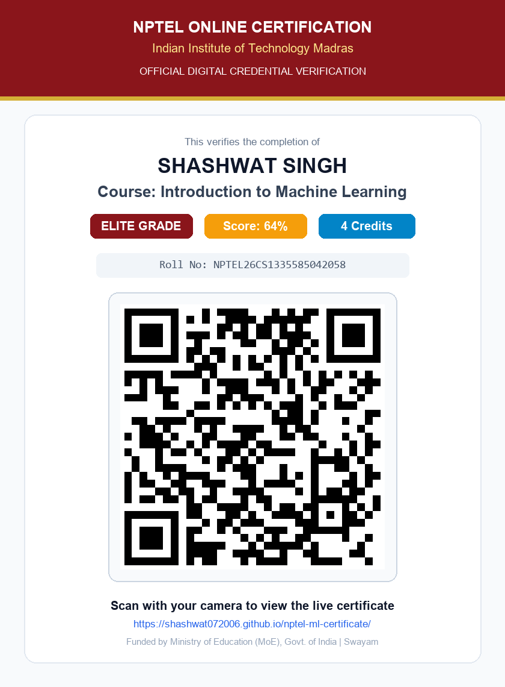

# NPTEL Certificate Verification - Shashwat Singh

Official verifiable digital credential portal for **Shashwat Singh**.

- **Course**: Introduction to Machine Learning (12-Week Course, Jul - Oct 2026)
- **Institution**: Indian Institute of Technology Madras (IIT Madras) & NPTEL
- **Grade**: Elite (Consolidated Score: 64%)
- **Assignments**: 24.85 / 25
- **Proctored Exam**: 39 / 75
- **Roll Number**: `NPTEL26CS1335585042058`
- **Live Verification URL**: [https://shashwat072006.github.io/nptel-ml-certificate/](https://shashwat072006.github.io/nptel-ml-certificate/)

---

### Verification QR Code Card
Scan the QR code below with any smartphone or camera to view the live certificate:

  

### Direct QR Code

  

